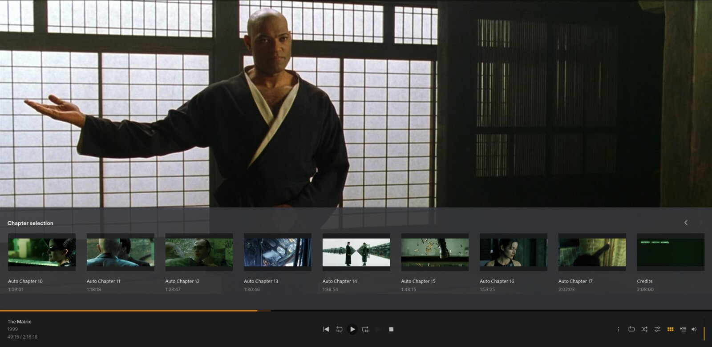
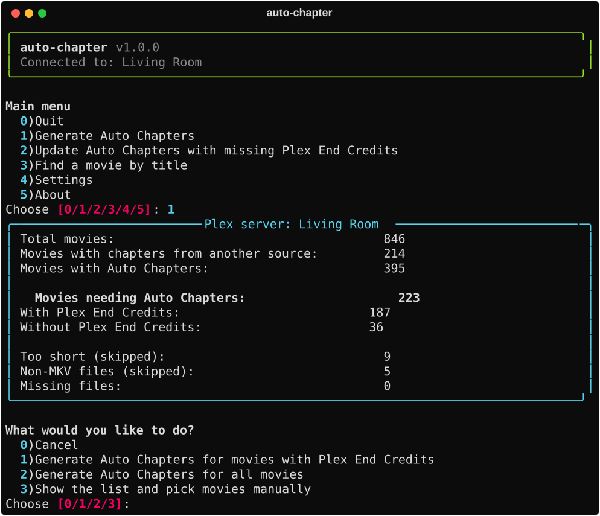
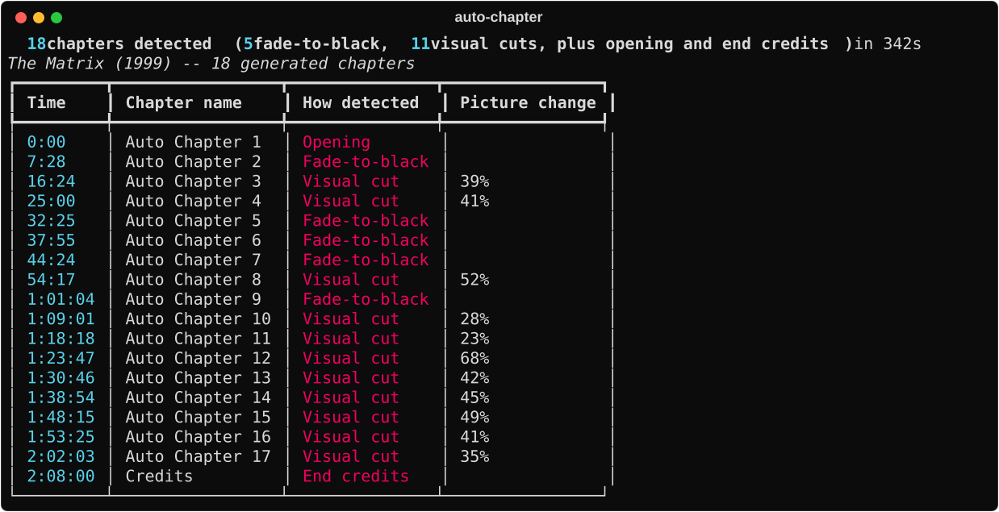

# auto-chapter

**v1.1.0**

**Chapters for the movies on your Plex server, made automatically.**

Most movie files come without chapters, so in Plex all you can do is drag
the timeline. auto-chapter finds the scene changes in the MKV movies on your
Plex Media Server with its own scene detection method, and writes chapter
markers into the files. On any Plex player you can then jump from scene to
scene, or straight to the end credits.



- **Its own detection method**: it finds natural scene boundaries by
  itself -- a fade to black first, the strongest visual cut where there is
  none -- and keeps the chapters evenly spread through the movie.
- **End Credits chapter**: wherever Plex has found the end credits.
- **Safe**: nothing is re-encoded, and the original file is replaced only
  when the new one is complete and checked.
- **Chapters in the file**: they stay in the MKV file, so other players
  (VLC, mpv, Kodi) show them too.
- **Easy**: an installer sets everything up, then a numbered menu does the
  rest.
- **Your setup**: auto-chapter runs on Linux; Plex can run on this computer
  or on another machine (for example a NAS), as long as its movie folders are
  reachable from here.

## Contents

- [Quick Start](#quick-start)
- [Requirements](#requirements)
- [Your files](#your-files)
- [What it does](#what-it-does)
- [Features](#features)
- [Development](#development)
- [Contributing](#contributing)
- [License](#license)

## Quick Start

Download `auto-chapter-vX.Y.Z.zip` from the
[Releases page](https://github.com/balazs-katona/auto-chapter/releases/latest)
(not the "Source code" files), then:

```bash
unzip auto-chapter-vX.Y.Z.zip
cd auto-chapter-vX.Y.Z
./install.sh
```

The installer checks required tools and offers to install the missing ones,
asks for your Plex URL and token,
walks you through mapping your movie folders, and sets everything up. Zero
folders mapped is fine too -- add them later from the app's Settings menu.
When done, type `auto-chapter` from any directory to start.

**INSTALL.md**: installation and first use, step by step. **ADVANCED.md**:
details for advanced users. **CHANGELOG.md**: what changed in each version.

## Requirements

- Linux with systemd. On Debian/Ubuntu, Arch, Fedora and openSUSE (and
  systems based on them) the installer can install the tools below for you.
  Tested on EndeavourOS and Ubuntu. Fedora and openSUSE should work but
  haven't been tested yet -- reports are welcome:
  https://github.com/balazs-katona/auto-chapter/issues
- [uv](https://docs.astral.sh/uv/) -- it also provides Python 3.13+ if your
  system has none
- ffmpeg, ffprobe (FFmpeg 4.4 or newer: the detection needs the `blackdetect` and `scdet` filters;
  it must decode H.264 and HEVC video -- the installer and the app warn if it can't)
- mkvmerge, mkvextract (from mkvtoolnix)
- A Plex Media Server with an auth token
- The movie files reachable from this computer: on its own disk, or a
  network share mounted here (for example from a NAS)

## Your files

auto-chapter **rewrites your MKV files** to add the chapters. Video, audio and
subtitles are copied unchanged (no re-encoding); only the file around them is
rebuilt. The original is replaced only after the new file is complete and
checked, so an interruption never leaves a half-written movie. It does not
touch a movie that is being watched, and needs free space for one extra copy
of the movie plus 5 GB while it works.

If a movie is a hard link (one file under two names, for example in a
download folder and in the Plex folder), the link is split: the Plex copy
gets the chapters, the other copy stays as it was. Until that other copy is
deleted, the movie takes twice the space.

Still, it writes into your movie collection: **keep a backup of anything you
can't replace**, and try it on a few movies first. Details: "What happens to
your files" in ADVANCED.md.

## What it does

**How it finds the chapters** (auto-chapter's own method):

1. The first chapter is the start of the movie.
2. From minute 5 on, it examines the movie five minutes at a time. In each
   stretch it looks for a fade to black, because that is where a scene ends
   on purpose; if there is none, it takes the strongest visual cut. What it
   finds there is the next chapter.
3. From that chapter it jumps five minutes ahead and examines the next
   stretch, and so on.
4. If Plex has found the end credits, the search stops five minutes before
   them, and the last chapter is End Credits. If not, it stops 15 minutes
   before the end of the movie, so no chapter lands in the credits.

The aim is chapters spread evenly through the movie, about as many as an
original chapter list would have.

Once running, `auto-chapter` gives you a numbered menu:



- **Generate** scans your mapped folders, shows how many movies need chapters,
  and processes them in alphabetical order -- **only the movies with Plex
  End Credits** (end credits Plex has already detected; the first choice),
  or all of them -- or a manual pick from the list. You choose how many;
  Enter means all of them. Writing starts right after that choice, with no
  extra question. Movies without Plex End Credits get no End Credits chapter
  now; once Plex has found their end credits, run the **Update** menu
  yourself to add it. If a manual pick includes such movies, you're asked
  how to handle them.
- **Update** catches movies that got their chapters before Plex had detected
  their Plex End Credits, and regenerates just those with the End Credits
  chapter added.
- **Find a movie by title** lets you (re)process one specific movie by name,
  including one that already has Auto Chapters. You see the chapters first
  and decide whether to write them. If a movie matches but can't be
  processed (for example it probably already has a useful chapter list from
  another source), you are told why.
- **Settings** covers folder mappings (add/change/remove/enable/disable),
  minimum movie length, the chapter threshold (from how many chapters on a
  movie is assumed to have a useful chapter list already), and your Plex
  connection.

For each movie it shows the chapters it found, then writes them into the file.
This is The Matrix (1999), the movie in the picture at the top:



While movies are being processed, `Ctrl+C` once finishes the current movie
and then stops, twice stops at once. Press `s` to switch the computer off
when the work is done (`s` again cancels).

## Features

- Interactive menu, no command-line flags to remember
- Standard-compliant Matroska chapters (RFC 9559)
- Atomic write (temp file + `os.replace()`) -- the original file is never
  touched until the new one is fully written and checked; safe to
  interrupt at any point
- Active stream protection (won't modify a file currently being watched)
- Live progress bar during detection and during the mkvmerge remux
- Plex Analyze auto-triggered after writing
- You decide what gets written: Generate and Update process exactly the
  movies you chose; Find by title shows the chapters and asks first
- Friendly error messages -- network issues, missing tools, disk space,
  permissions, and so on are translated into a short, specific sentence,
  never a raw stack trace (the details go to the log file)
- Resilient to a temporarily unreachable Plex server or network share --
  keeps running, retries automatically where it can, and always leaves you
  a way to fix it (never gets stuck with no way out)
- Required external tools (ffmpeg, mkvmerge, etc.) are re-checked on every
  launch, not just at install time
- Runs fine with zero folders mapped; tells you where to add one instead of
  crashing
- Keeps the computer from going to sleep because it was idle while it works
  (systemd; skipped where it is not available)
- Optional power-off when a batch is done (`s` key)

## Development

```bash
uv sync --extra dev            # adds the test and lint tools (pytest, ruff, mypy)
uv run pytest                  # run tests
uv run ruff check src tests    # lint
uv run mypy src                # type check
```

## Contributing

Bug reports, test reports from other Linux systems and ideas are welcome:
see [CONTRIBUTING.md](CONTRIBUTING.md).

## License

Copyright (C) 2026 Balazs Katona

auto-chapter is free software: you can redistribute it and/or modify it under
the terms of the GNU General Public License as published by the Free Software
Foundation, either version 3 of the License, or (at your option) any later
version. It comes with **no warranty**. See [LICENSE](LICENSE) for the full
text.
